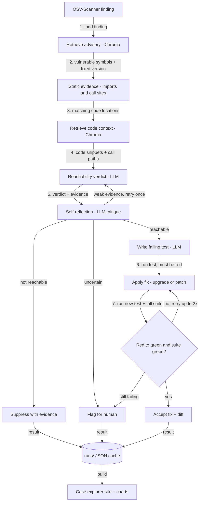

# Reachability Triage: Project Plan

> **For Claude Code:** this plan runs under the `/autonomous-build` skill. The skill holds the general working rules (no mid-run questions, DECISIONS.md, PROGRESS.md, honest results, handoff). This file only adds what is specific to this project. **Where this plan and the skill disagree, this plan wins.**

---

## 0. Before you start (for Charlie, not Claude Code)

**Personal computer only**, never a work laptop (see Section 10).

Same setup as Bulwark: plain Windows, with Docker Desktop running. You don't install Linux. Claude Code builds and manages the Linux containers it needs by itself (Section 1.5).

1. **Docker Desktop running**, same as for Bulwark.
2. **No API key set** in the terminal you launch from, so Claude Code and the agent both run on your subscription. In PowerShell:
   ```powershell
   Remove-Item Env:ANTHROPIC_API_KEY -ErrorAction SilentlyContinue
   ```
3. **Local model for the comparison run (already downloaded):** `lmstudio-community/Qwen2.5-Coder-14B-Instruct-GGUF`, Q4_K_M, in your local model app.
   - In the app, go to **Settings → Local Model API** and turn the server **on**. Note the address it shows (usually `http://localhost:1234`).
   - Make sure **Qwen2.5 Coder 14B Instruct** is loaded (it's already selected in your chat window).
   - Leave the app open while Claude Code works. If the server isn't reachable, Claude Code skips the local-model comparison and notes it.
4. **Launch:** open `C:\dev\reachability-triage` (already created, with this file in it) in VS Code, and in the integrated terminal run:
   ```powershell
   claude --dangerously-skip-permissions
   ```
   Then send:
   ```
   /autonomous-build reachability-triage-plan.md
   ```
5. **At the end (about 1 hour):** review the drafted labels for the real-repo findings using the label review page (M5). Real-repo numbers stay marked "provisional" until you do. After reviewing, run the refresh command the handoff gives you (eval, assets, site) to update every number.
6. **Possible extra step:** if Claude Code can't call Claude from inside its own session (see Section 1.1), the handoff will ask you to run one command, `rt showcase`, in a normal terminal. It runs unattended; you just start it.

**If it stops** (usage limit, Agent SDK credit, crash): send `/autonomous-build` again and it continues from `docs/PROGRESS.md`.

---

## 1. Project-specific rules (on top of the skill)

### 1.1 How the agent calls an LLM
The agent has three LLM providers, chosen in config:

| Provider | What it is | Used for |
|---|---|---|
| `claude-code` | Claude through the Claude Agent SDK (Python) or `claude -p --output-format json`, authenticated with Charlie's existing Claude Code login | the showcase runs |
| `local` | any OpenAI-compatible endpoint (Charlie's local model app) | the local-model comparison |
| `mock` | deterministic canned responses | tests and development |

Rules for the `claude-code` provider:
- **Text in, text out only.** Disable all Claude Code tools and limit each call to a single turn. LangGraph is the orchestrator; Claude only reasons at each step.
- **Isolate each call from this project.** Run it from a neutral temporary working directory, with project settings, `CLAUDE.md` files, skills, and MCP servers not loaded. Otherwise this repo's instructions and the `/autonomous-build` skill leak into the agent's prompts, add tokens, and change its behavior.
- **Never use `--bare` mode** or anything that requires `ANTHROPIC_API_KEY`. Never set or ask for an API key.
- Look up the current Agent SDK / headless flags in the official docs before writing the provider; don't rely on memory.
- **Nested sessions:** you (Claude Code) will be calling Claude Code from inside your own session. If the nested call is refused because a parent session is detected (e.g. a `CLAUDECODE` environment variable), remove that variable from the subprocess environment only. If nested calls still fail, finish everything else on `mock`, and put the full showcase eval behind one command, `rt showcase`, that Charlie runs once in a normal terminal. It must run unattended, resume from the cache, and print a short summary at the end. Record this in the handoff.
- **Structured output:** every LLM node asks for JSON that matches a Pydantic schema. On invalid JSON, retry once with the validation error included; if it fails again, record the finding as `uncertain` with reason `parse_error`. Never crash the run.
- Programmatic use may draw from a separate monthly Agent SDK credit. **If a call fails with a usage, credit, or rate-limit error:** stop that run cleanly, save progress, record it in PROGRESS.md, and move on to work that needs no LLM calls. Never enable paid extra usage.

### 1.2 Budget and caching
- **Every LLM response is cached to disk** under `runs/<config>/<finding_id>.json`. A rerun skips findings that already have a result. This makes runs resumable, keeps credit use low, and lets the committed runs reproduce every chart.
- **Develop on `mock` and on 3 to 5 findings.** Only run the full eval once the pipeline is finished and the eval config is frozen.
- **Run order for the full eval** (so a partial run still yields the headline result): (1) full pipeline on the synthetic test split, (2) full pipeline on the real set, (3) ablations, (4) remediation, (5) local-model run.
- Cap: at most **1,500 Claude calls total** across all eval runs. Log the count in PROGRESS.md.
- **Local model is slow.** Give each local call a 5 minute timeout. If the full local run would take more than about 4 hours, run it on the synthetic test split plus 20 real findings, and say so on the chart.

### 1.3 Labels and honesty
- **Synthetic benchmark:** ground truth comes from how each case is built, so it is final. Split it **before** writing the agent's prompts: about one third is a `dev` split you may use while building, the rest is a `test` split used only in the final eval. Never tune prompts on the test split.
- **Real-repo set:** labels are drafted by a **deterministic script with no LLM** (imports, call sites, which vulnerable symbols the advisory names), so the model being evaluated never grades itself. Every drafted label is stored as `status: pending_review` with its evidence. Charlie confirms them in the review page.
- **Small samples get error bars.** Report 95% bootstrap confidence intervals for precision, recall, and false-suppression rate, and show them on the charts. With 50 findings, a few points of difference is noise; say so instead of overclaiming.
- Real-set metrics are always shown as **provisional** until all labels are reviewed. Never present drafted labels as human-verified anywhere: README, charts, site, or CV bullet.
- The agent never sees the labels.

### 1.4 Target repos are read-only references
- Target apps are cloned into `workdirs/` (gitignored). Never commit whole target source files, and never push anything to the target projects' upstream repos.
- Run records and the case explorer may include **short excerpts** (the evidence lines and patch diffs), each with file path and a link to the upstream project. Add `THIRD_PARTY.md` listing each target, its license, and its upstream URL.
- **Every remediation attempt runs in isolation:** a fresh git worktree of the target, tested in a **throwaway container** started from that target's image (Section 1.5). The upgrade or patch happens only inside that container, so one fix attempt can't break the next.
- Test suite runs get a timeout (15 minutes per run). A timeout counts as a failed gate, with reason `timeout`.

### 1.5 Where things run (Windows host + Docker)
Charlie's machine is plain Windows with Docker Desktop. **Do not install WSL or ask Charlie to.** Split the work like this:

| Runs on the Windows host (Python 3.12 via `uv`) | Runs in Linux containers (Docker) |
|---|---|
| The agent: LangGraph, providers, RAG, Chroma, FAISS, embeddings | Each target app's environment: its pinned Python version, system packages (e.g. `libldap2-dev` for mealie), and its venv built from the lock |
| OSV-Scanner (Windows binary) and the static analysis (reads source files on disk) | Target test suites: baselines, failing tests, and the fix gate |
| The `claude-code` provider (uses the host's existing Claude Code login) and the `local` provider (endpoint per Section 1.6) | Nothing that calls an LLM |
| The case explorer, charts, Playwright screenshots | |

- Build **one image per target** (`docker/targets/<target>.Dockerfile`) with its system packages and venv baked in. Mount the target's worktree from `workdirs/` into the container at run time.
- Wrap all container calls in one Python module (e.g. `rt.sandbox.run_tests(target, worktree, test_ids)`), so the agent code never shells out to Docker directly.
- **Cross-platform tooling:** the Phase 0 Makefile may not work on Windows. Port its targets to `rt` CLI subcommands (e.g. `rt setup`, `rt scan`, `rt baseline`), and keep the Makefile only as a thin wrapper for Linux users. Use `pathlib` everywhere and write files from Python, not shell heredocs.
- Line endings: add a `.gitattributes` with `* text=auto eol=lf` so files mounted into the Linux containers don't break on CRLF.
- **Docker cleanup is allowed.** Charlie has approved removing anything in Docker if needed (containers, images, volumes, networks, build cache), e.g. to free disk space or fix a broken state. Prefer removing this project's own resources first (label everything you create with `project=reachability-triage`), and log any cleanup of other resources in PROGRESS.md. Never touch anything outside Docker.

### 1.6 Local model endpoint
- The local model is **Qwen2.5-Coder-14B-Instruct (Q4_K_M)**, served by Charlie's local model app through an OpenAI-compatible API.
- **Discover the endpoint, don't assume it:** try `GET /v1/models` on `http://localhost:1234`, then `11434`, `8080`, and `1337`. Use the first one that lists a Qwen2.5 Coder 14B model, and record the URL and exact model ID in config and DECISIONS.md.
- If no endpoint answers, write in QUESTIONS_FOR_CHARLIE.md: "Turn on Settings → Local Model API in your local model app," skip the `local` config, and continue.

---

## 2. Goal

**Build an agent that decides whether a dependency vulnerability actually matters for a given codebase, and fixes the ones that do, test-first. Prove it with real numbers.**

It should clearly show these skills:
- **Agent orchestration:** a LangGraph state graph with branching, retries, and a self-reflection step
- **RAG and vector databases:** retrieval over advisory text and over the target's code, with Chroma as the store and FAISS benchmarked against it
- **Embeddings:** local embedding model, retrieval quality measured
- **Security engineering:** reachability analysis, test-first remediation, false-suppression risk
- **Evaluation:** precision, recall, false-suppression rate, ablations, cost, and latency

**The project should look great.** Every piece feeds the portfolio website, slides, and a demo video. Keep the scope small and the finish polished. **Showcasing the technology well beats building lots of features.**

### One-line pitch
Scanners flag hundreds of vulnerable dependencies; most can't be reached from your code. This agent separates the real ones from the noise, shows its evidence, and fixes the real ones with a test that proves it.

---

## 3. Scope

### In scope
1. **Phase 0 import:** reuse the finished Phase 0 from the old repo (M0).
2. **Advisory RAG:** index advisory text (summary, details, affected versions, fixed versions, references, named vulnerable functions) in Chroma.
3. **Code RAG:** index each target's source as function-level chunks.
4. **Reachability agent (LangGraph):** retrieve, gather static evidence, give a verdict with evidence, self-reflect, then route by verdict.
5. **Remediation (test-first):** for a capped set of reachable findings (10 max), write a failing test, then apply a fix (prefer upgrading to the fixed version; code patch only if the upgrade breaks the suite), and accept only if the new test goes red to green and the existing suite stays green.
6. **Synthetic benchmark:** 25 to 30 small cases with known ground truth.
7. **Real-repo eval set:** a stratified sample of 50 of the 156 real findings.
8. **Eval and ablations,** including the local-model comparison.
9. **Case explorer:** a static site built from the committed run results.
10. **Label review page:** a local page for Charlie to confirm drafted labels quickly.
11. **Visual assets and portfolio kit.**

### Out of scope (do not build)
- Languages other than Python. A live hosted agent. Fine-tuning. Opening PRs on the real target projects. A general-purpose SAST tool.

---

## 4. Architecture



Each node writes its inputs, outputs, tokens, and latency into the finding's run record. The case explorer and all charts are built only from these records.

---

## 5. Stack (keep it to this)

| Piece | Choice |
|---|---|
| Language / env | Python 3.12 for the agent, `uv`; target apps keep their own pinned Python versions (from Phase 0) |
| Orchestration | LangGraph |
| LLM | Providers from Section 1.1 (`claude-code`, `local`, `mock`) |
| Embeddings | Local sentence-transformers model (e.g. `BAAI/bge-small-en-v1.5`), no API |
| Vector stores | Chroma (main), FAISS (benchmark only) |
| Scanner | OSV-Scanner with the pinned offline advisory DB (from Phase 0) |
| Static evidence | Python `ast` for imports and call sites; ripgrep as a fallback |
| CLI | the existing `rt` CLI, extended |
| Case explorer | static HTML + vanilla JS + Tailwind via CDN, reads JSON, no build step |
| Charts | matplotlib (PNG/SVG) + Plotly (interactive HTML) |
| Screenshots | Playwright (headless) |
| Quality | ruff, pytest, GitHub Actions |

---

## 6. Visual design rules

Use the **same base look as Bulwark** so the portfolio feels like one body of work, with a different accent so each project is recognizable.

- **Dark theme everywhere.** Background `#0B0F17`, panels `#131A26`, borders `#1F2937`, text `#E5E7EB`, muted `#9CA3AF`.
- **Accent:** violet `#A78BFA`.
- **Verdict colors:** reachable `#EF4444` (red), not reachable `#22C55E` (green), uncertain `#F59E0B` (amber), fixed `#38BDF8` (cyan).
- **Fonts:** Inter for UI, JetBrains Mono for code, diffs, IDs, and test output.
- **Product name and logo:** pick a short name (log it in DECISIONS.md) and a simple SVG logo. Use it everywhere.
- **Charts:** dark, same palette, large labels, a title that states the takeaway, no chart junk. Export PNG (1600px wide) and SVG to `assets/charts/`.
- **Case explorer:**
  - **Overview page:** headline metrics as big stat cards, the verdict breakdown, and links to charts.
  - **Findings table:** filter by target, verdict, correct/incorrect, and config.
  - **Case page (the star):** a vertical timeline of the agent's steps for one finding: scanner alert → advisory retrieved → code evidence with the call path highlighted → verdict with confidence → reflection → failing test output (red) → patch diff → passing output (green). Each step shows its latency and tokens.
  - A "featured cases" row on the overview: 3 to 5 of the most interesting cases (a clear catch, a correct suppression, a full red-to-green fix, and one honest failure).
- **Graph diagram:** render the LangGraph graph (its built-in Mermaid export), restyled in the palette.

---

## 7. Milestones

### M0: Setup and Phase 0 import
1. Do the environment checks the skill describes, plus: confirm Docker Desktop is running, and confirm `claude` is logged in with a subscription (not an API key) and that `ANTHROPIC_API_KEY` is not set.
2. Create a new **private** repo, `reachability-triage`, rename this file to `PLAN.md`, and set up `docs/`.
3. **Import Phase 0** from `https://github.com/Charlie-Gzz/agentic-vuln-triage`: `targets.yaml`, `locks/`, `data/` (raw scans, `findings.jsonl`, baselines), the `rt` CLI, the Makefile targets, and the tests. Keep its design decisions; copy them into the README and DECISIONS.md. Do not copy its git history. If the repo is unreachable, rebuild Phase 0 from its README description and note it.
4. Port the Phase 0 Makefile targets to `rt` subcommands (Section 1.5), and build the per-target Docker images with their system packages and venvs.
5. Run `rt tools`, `rt db`, `rt setup`, `rt scan` and confirm the findings match the committed `findings.jsonl`.
6. **Run `rt baseline` in the containers** (about 9 minutes) and save the results. The remediation gate compares against these results, not the committed ones, since test outcomes can differ by environment. Record any tests that fail or flake at baseline; the gate ignores them.
7. Check the providers: `mock` works; `claude-code` answers one tiny prompt (Section 1.1 covers nested-session issues); `local` answers at the endpoint found per Section 1.6. Record what's available in PROGRESS.md.

**Done when:** the new repo has Phase 0 working end to end, and the provider status is recorded.

### M1: RAG layer
- Advisory index in Chroma, built from the pinned advisory DB.
- Code index per target: function-level chunks with file path and line numbers.
- Retrieval interface shared by Chroma and FAISS.
- A small retrieval check: for 15 to 20 findings where the vulnerable symbol is known, measure whether the right advisory and code chunk land in the top-k.

**Done when:** `rt index` builds both indexes, and the retrieval check reports recall@5 and latency for Chroma and FAISS.

### M2: Reachability agent
- LangGraph graph per Section 4, up to the routing step (no remediation yet).
- Static evidence node: imports of the vulnerable package, call sites of named vulnerable symbols, and the path from an entry point (view, route, CLI) where it can be found.
- Verdict node: structured output (`reachable` / `not_reachable` / `uncertain`, confidence, evidence list with file:line).
- Self-reflection node behind a config flag (needed for the ablation).
- Retrieval behind a config flag (needed for the ablation).
- `rt triage <finding_id>` and `rt triage --all --config <name>`, with the cache from Section 1.2.

**Done when:** the full graph runs on `mock` for all findings, and on `claude-code` for 3 to 5 findings with sensible verdicts.

### M3: Test-first remediation
- Test-writer node: writes a test that exercises the vulnerable behavior through the app's code path.
- Runs the test in the target's venv; it must fail first. A test that passes before the fix is rejected and regenerated (max 2 tries).
- Fix node: upgrade to the fixed version in the target's lock first; if that breaks the suite, try a minimal code patch.
- Gate: new test red → green, and the existing suite matches the Phase 0 baseline.
- Capped at 10 reachable findings, preferring ones where a meaningful test is realistic.

**Done when:** at least one finding goes fully red → green with the suite intact, all on the `claude-code` provider, and failures are recorded with reasons.

### M4: Synthetic benchmark
- 25 to 30 small Python apps under `bench/`, each pinned to a real vulnerable package version, covering:
  - imported and the vulnerable function called from an entry point (reachable)
  - imported but the vulnerable function never called (not reachable)
  - only a non-vulnerable part of the package used (not reachable)
  - vulnerable function called only from dead code or tests (not reachable)
  - called through a wrapper or indirection (reachable, harder)
  - called, but only in a configuration that disables the vulnerable feature (hard; label per the advisory)
- Ground truth in `bench/labels.jsonl`, written when each case is built, with the `dev` / `test` split from Section 1.3.
- Make the apps look like real code (realistic names, a few files each), so the case name and file names don't give the answer away (e.g. no `unused_vuln.py`).

**Done when:** the benchmark runs through `rt triage` like any other target.

> **Build order note:** build M4 (the synthetic benchmark and its split) **before** finalizing the agent prompts in M2, so prompts are only ever tuned on the `dev` split. It's fine to do M2's plumbing on `mock` first, then M4, then finish M2's prompts.

### M5: Real-set labels and the review page
- Pick a stratified sample of 50 real findings (spread across the 3 targets and severities). Log the sampling method.
- Draft labels in a separate script that does not use the agent's outputs, with evidence, as `pending_review`.
- **Label review page** (`rt review`, served locally): one finding per screen with the advisory, the evidence, and the drafted label. Buttons: Confirm / Change to reachable / Change to not reachable / Uncertain, plus a notes box. Keyboard shortcuts for speed. Saves to `data/labels.jsonl`.

**Done when:** the review page works, and every real-set label is either reviewed or clearly marked pending.

### M6: Evaluation
Freeze the eval config (logged in DECISIONS.md) **before** running. Then run in the order from Section 1.2:

| Config | Retrieval | Reflection | Model |
|---|---|---|---|
| `full` | on | on | Claude |
| `no-retrieval` | off | on | Claude |
| `no-reflection` | on | off | Claude |
| `local` | on | on | local model (if available) |

- Synthetic results use the `test` split only.
- `rt eval` computes the Section 8 metrics (with confidence intervals) per config and per dataset, from the cached runs only.
- Output `eval/results/results.json` and a markdown table.

**Done when:** `rt eval` regenerates every number from the committed runs with no LLM calls.

### M7: Case explorer, assets, and portfolio kit
- Build the case explorer per Section 6 into `site/`, from the committed runs and results. Prepare a GitHub Pages workflow, but **do not enable Pages** (the repo is private; Charlie enables it after making the repo public).
- `rt assets` generates into `assets/`:
  - `charts/`: ablation chart (precision, recall, false-suppression by config), local vs Claude chart, retrieval chart (Chroma vs FAISS recall@k and latency), cost and latency per finding, remediation funnel (reachable → test red → fixed green). PNG + SVG each, plus one interactive Plotly page.
  - `screenshots/`: the overview, findings table, each featured case page, and the review page.
  - `diagram/`: the LangGraph graph and architecture diagram, in the palette.
- `docs/DEMO_SCRIPT.md`: a 2 minute video script following one featured case from alert to green test.
- `docs/SLIDES_OUTLINE.md`: 6 to 8 slides (problem, approach, graph, a case walkthrough, results, lessons), naming the asset for each slide.
- `docs/PORTFOLIO_CARD.md`: title, pitch, headline metric, 3 bullets, tech tags, and a draft CV bullet (real-set numbers marked provisional if labels are pending).

**Done when:** `rt assets` and `rt site` run clean, and every asset matches Section 6.

### M8: README and handoff
- README: logo, pitch, a hero screenshot of a case page, the graph diagram, results table, quickstart, "how it works", Phase 0 design decisions, limitations.
- Handoff per the skill. Add these two items:
  1. how many real-set labels are pending review and the command to open the review page
  2. total Claude calls used and whether any run stopped on a credit or usage limit

**Done when:** a stranger could clone the repo, open the case explorer, and understand a case in under 5 minutes.

---

## 8. Metrics to report

| Metric | What it shows |
|---|---|
| Precision on "reachable" | how often an alert it raises is real |
| Recall on "reachable" | how many real issues it catches |
| **False-suppression rate** | real issues it wrongly marked not reachable; the dangerous error, so lead with it |
| Noise reduction | share of findings it can safely suppress |
| Uncertain rate | how often it hands off to a human |
| Remediation success | reachable → failing test → green fix with suite intact |
| Retrieval recall@5, Chroma vs FAISS | RAG quality and store trade-off |
| Cost (tokens) and latency per finding | what it takes to run |
| Ablation deltas | what retrieval and reflection each add |
| Local vs Claude | how a small local model compares |

For cost on the `claude-code` provider, report tokens and an API-price equivalent, labeled as an estimate.

Headline format: **"Suppresses X% of scanner noise with a Y% false-suppression rate, and fixed Z real vulnerabilities test-first."**

---

## 9. Stretch (only after M8, in this order)

1. GIF of a case page for the README.
2. A second local model size (7B vs 14B) in the comparison chart.
3. A transitive-dependency case set (the vulnerable package is pulled in by another dependency).

---

## 10. Boundaries

- Personal project, personal machine, public repos and public advisory data only.
- Nothing from Charlie's employer: no code, scanner output, internal tools, or internal findings.
- The pattern is general; this implementation is built from scratch on public data.

---

## 11. Repo layout (target)

```
reachability-triage/
  PLAN.md
  README.md
  Makefile
  pyproject.toml
  targets.yaml
  locks/                 # from Phase 0
  data/                  # findings, raw scans, baselines, labels.jsonl
  src/reachability_triage/
    cli.py               # rt CLI
    scan/                # Phase 0 scanning
    rag/                 # indexes, retrieval, Chroma + FAISS
    agent/               # LangGraph graph, nodes, providers
    remediate/           # test writer, fixer, gate
    eval/                # metrics, ablations
    review/              # label review page
  bench/                 # synthetic benchmark apps + labels
  runs/                  # cached run records per config (committed)
  eval/results/
  site/                  # case explorer (static)
  assets/                # charts, screenshots, diagrams
  workdirs/              # cloned targets (gitignored)
  docs/                  # DECISIONS, QUESTIONS_FOR_CHARLIE, PROGRESS, HANDOFF, DEMO_SCRIPT, SLIDES_OUTLINE, PORTFOLIO_CARD
  tests/
```
