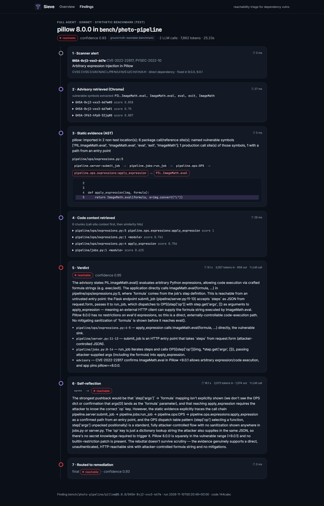
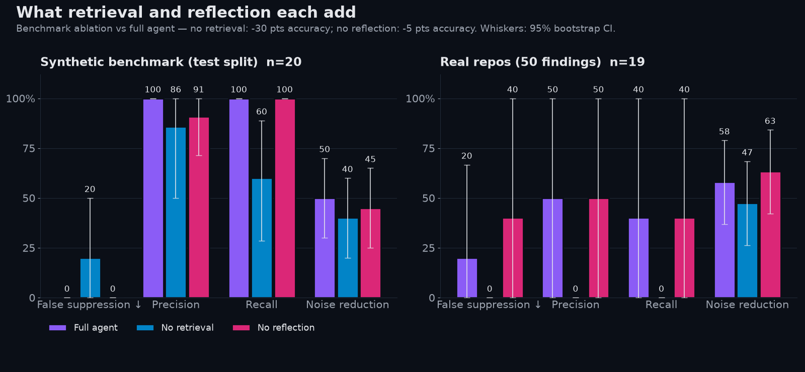
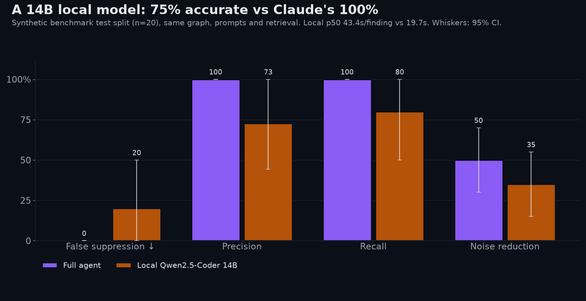
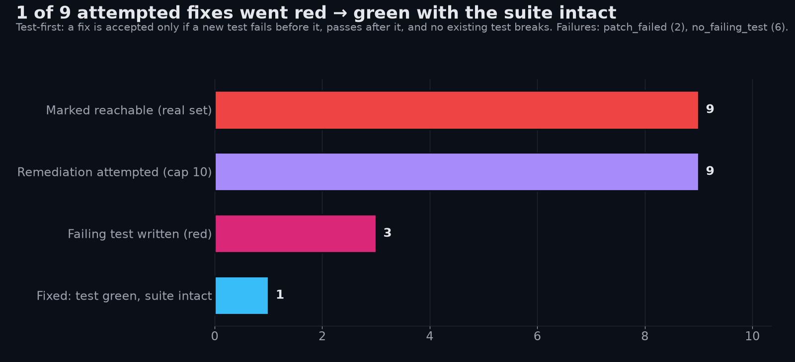
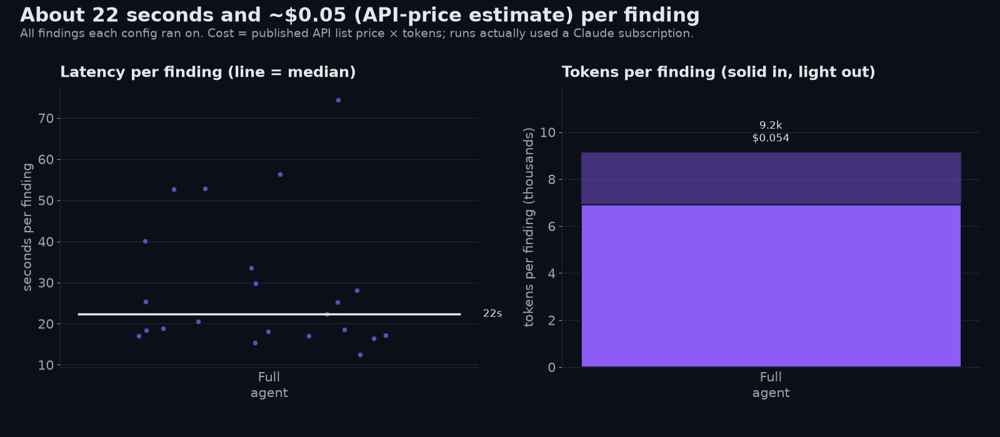

<p align="center"></p>

<h1 align="center">Sieve</h1>

<p align="center"><b>Agentic reachability triage and test-first remediation for Python dependency vulnerabilities.</b><br>
Scanners flag hundreds of vulnerable dependencies. Most can't be reached from your code.<br>
Sieve sorts the real ones from the noise, shows its evidence, and tries to fix the real ones with a test that proves it.</p>

---

**Results.** On real repos, Sieve suppressed 58% of graded scanner findings (19 graded findings). In doing so it
suppressed 1 of the 5 findings that were truly reachable. Test-first remediation turned 1 of 9 attempts from a
failing test to a passing one with the existing suite intact. That one fix has a caveat, explained under
[Limitations](#limitations). On the synthetic benchmark (n=20) the full agent got all 20 right. Every number on
this page is regenerated from committed run records by `rt eval`, which makes no LLM calls.



## What it does

For each scanner finding (one app, one package, one version, one advisory), Sieve runs a LangGraph pipeline:



1. **Load the finding.** It comes from [osv-scanner](https://github.com/google/osv-scanner), run against the
   *installed* production dependencies.
2. **Retrieve the advisory.** Chroma index over GHSA + PyPA advisories. Vulnerable symbols are pulled out of the
   advisory text by fixed rules, with no LLM.
3. **Gather static evidence.** Pure `ast` analysis: imports, call sites of the vulnerable symbols, a call path back
   to an entry point (route, view, CLI command, job), config-string and template references, and what was searched,
   so that "zero matches" carries meaning.
4. **Retrieve code context.** Similarity search over the app's code, with production call sites placed first.
5. **Verdict.** Claude returns structured JSON: `reachable` / `not_reachable` / `uncertain`, a confidence, and
   evidence as `file:line` references.
6. **Self-reflection.** A second call critiques the verdict and can trigger one retry.
7. **Route.** `not_reachable` is suppressed, `uncertain` is flagged for a human, `reachable` goes to remediation.

**Test-first remediation** (`rt remediate`): Claude writes a regression test that fails on the vulnerable version
(it must go *red* for the right reason). Sieve then tries the smallest upgrade and, if that's rejected, a code patch.
A fix is accepted only when the new test goes green **and** the target's whole existing suite still passes against
its recorded baseline. Everything runs inside the target's Docker image.

The **case explorer** in `site/` is a static site that shows every run step by step: the advisory chunks retrieved,
the call path, the raw model output, and the remediation diff. Open `site/index.html` directly from disk.

## Results

The 95% intervals in brackets are percentile bootstraps over findings. With samples this small, differences that
fall inside the intervals are noise. Full tables: [`eval/results/results.md`](eval/results/results.md).

**Real repos:** healthchecks (Django), CTFd (Flask), mealie (FastAPI). 50 findings sampled from 156, all
labels human-reviewed. 31 of the 50 labels are `uncertain` and excluded from grading, leaving 19 graded findings,
of which 5 are truly reachable.

| Config | Reachable suppressed | Caught | False alarms | Noise reduction | Uncertain | Calls / finding | p50 latency |
|---|---|---|---|---|---|---|---|
| Full agent (claude-sonnet-5) | 1 of 5 | 2 of 5 | 2 | 58% [37–79] | 16% | 2.3 | 36 s |
| No retrieval | 0 of 5 | 0 of 5 | 1 | 47% [26–68] | 47% | 2.9 | 50 s |
| No reflection | 2 of 5 | 2 of 5 | 2 | 63% [42–84] | 5% | 1.0 | 14 s |
| Local Qwen2.5-Coder 14B (20-finding subset, 6 graded) | 2 of 2 | 0 of 2 | 0 | 67% | 0% | 2.6 | 77 s |

**Synthetic benchmark:** 30 small apps written for this project, split into 10 dev and 20 test cases before any
prompt existed. Test split shown.

| Config | False suppression | Precision | Recall | Noise reduction | Est. $ / finding |
|---|---|---|---|---|---|
| Full agent | 0% [0–0] | 100% | 100% | 50% (all 10 not-reachable) | 0.051 |
| No retrieval | 20% [0–50] | 86% | 60% | 40% | 0.050 |
| No reflection | 0% [0–0] | 91% | 100% | 45% | 0.023 |
| Local Qwen2.5-Coder 14B | 20% [0–50] | 73% | 80% | 35% | 0 (local) |

What the ablations show:

- **Retrieval carries the agent.** Without it, recall on the benchmark falls from 100% to 60%, and on the real set
  the agent marks almost half of all findings uncertain.
- **Reflection costs twice the calls and helps at the margin.** On the benchmark it removes a false alarm
  (precision 91% → 100%). On the real set it halves the number of reachable findings wrongly suppressed (2 → 1).
- **A 14B local model is not a drop-in replacement.** It runs on the same graph, prompts and retrieval, and is
  less accurate and slower.

Cost is an API-list-price *estimate*. The runs used a Claude subscription through `claude -p`, so no API key was
involved. Retrieval: advisory recall@5 is 0.98 (n=186) and code recall@5 is 1.00 (n=22). Chroma and FAISS give
identical recall here. FAISS is faster unfiltered; Chroma is faster with a metadata filter.

| | |
|---|---|
|  |  |
|  |  |

## Quickstart

Requirements: Python 3.12 with [uv](https://docs.astral.sh/uv/), Docker (needed for baselines and remediation),
and a logged-in `claude` CLI (for the `claude-code` provider). The local model is optional.

```bash
uv sync
open site/index.html                 # browse every committed case; no setup needed (on Windows: start site\index.html)
uv run rt eval                       # recompute every number from runs/ (no LLM calls)

# Phase 0: reproduce the findings from pinned inputs
make tools db setup scan             # osv-scanner binary, pinned advisory DB, target venvs/locks, scan

# Triage and remediation (cached per finding, resumable)
uv run rt triage --all --dataset bench --split test --config full
uv run rt remediate --config full --max 10
uv run rt showcase --skip-local      # the whole frozen eval, in order
bash scripts/eval_unattended.sh      # same, waits out usage limits, adds the local model, then refreshes

uv run rt review                     # label review page (http://127.0.0.1:8765)
uv run rt refresh                    # eval + charts/screenshots + site
uv run pytest -q                     # unit tests (no network, no LLM)
```

Run configs live in `eval/configs/*.yaml`. Providers: `claude-code` (`claude -p` with every tool disabled, one turn,
replaced system prompt, no CLAUDE.md/MCP/settings), `local` (any OpenAI-compatible endpoint, e.g. LM Studio), and
`mock` (deterministic, used for development).

## How the evaluation was kept honest

- **Benchmark before prompts.** The 30 benchmark cases and their dev/test split were committed before any prompt
  existed. Prompt changes were made only after looking at dev cases and 3 real findings outside the eval set
  ([DECISIONS](docs/DECISIONS.md)).
- **Labels independent of the agent.** Real-set labels were drafted by a separate regex script that shares no code
  with the agent, then every label was reviewed by a human using [written criteria](docs/LABEL_GUIDE.md). 27 of the
  50 drafts were changed. The agent never sees labels.
- **Frozen eval config.** Models, retrieval settings and datasets were fixed in a commit before the eval ran. Every
  run record (prompts, raw output, tokens, timing) is committed in `runs/`.
- **Post-hoc changes are disclosed.** One benchmark label was corrected after the agent disagreed with it. The
  advisory's precondition wasn't met, which was verified in a container. That correction favours the agent and is
  recorded in DECISIONS.

## Phase 0 design decisions

These are carried over from [agentic-vuln-triage](https://github.com/Charlie-Gzz/agentic-vuln-triage):

- **Scan what's installed, not what's declared.** Each target's venv holds production dependencies only and is
  frozen to `locks/<target>.runtime.txt`, which is what gets scanned. `requirements.txt` misses transitive
  dependencies (healthchecks declares 11 packages but installs 25), and a full lock includes dev tools that never
  run in production.
- **Pinned advisory DB.** osv-scanner's offline DB is built from the GitHub and PyPA advisory databases at commits
  pinned in `targets.yaml`, so a rescan reproduces the committed findings exactly.
- **One finding = one (target, package, version, vulnerability).** Aliases (GHSA / PYSEC / CVE) are grouped.
- **Test baselines recorded up front,** so the remediation gate can ask "did anything get worse than before?"
- **Targets pinned by commit:** healthchecks v1.25.0, CTFd 3.4.0, mealie v1.0.0. They are used as read-only
  references ([THIRD_PARTY](THIRD_PARTY.md)).

## Limitations

- **Small samples.** 19 graded real findings with 5 truly reachable, and 20 benchmark cases. Treat the real-set
  rows as a field test, not a precise rate. The benchmark is probably on the easy side.
- **Many findings resist labelling.** 31 of 50 real findings were labelled `uncertain`: mostly transitive or
  framework-internal vulnerabilities where proving reachability means tracing library internals. That is also
  where the agent hands off to a human.
- **One labeller.** Every real label came from a single reviewer. There was no inter-rater check.
- **The one "fix" isn't mergeable as-is.** The healthchecks urllib3 fix passed the gate (red → green, 1,062/1,062
  tests) by upgrading urllib3 to 2.6.0, but `requests==2.27.1` declares `urllib3<1.27`. The gate has since gained a
  `uv pip check` step that would reject this upgrade. The committed result predates that step and is reported as is.
- **Remediation is hard.** 6 of 9 attempts never produced a regression test that failed for the right reason, and
  2 code patches failed.
- **Static analysis is name-based.** Inside the project it resolves import aliases and builds a call graph from
  function names. Dynamic dispatch and framework magic are approximated, not resolved.
- **Python only.** Three web frameworks; one local model size.

## Repository map

```
src/reachability_triage/   scan/ (Phase 0), rag/, agent/ (graph, static analysis, providers), remediate/,
                           eval/ (metrics, showcase), review/, outputs/ (assets, site)
bench/                     synthetic benchmark apps + labels
data/                      findings, eval set, real-set labels
runs/                      every run record (committed), _ledger.jsonl = one line per Claude call
eval/                      frozen configs + results
site/  assets/             case explorer, charts, screenshots, diagrams
docs/                      DECISIONS, LABEL_GUIDE, PROGRESS, HANDOFF, DEMO_SCRIPT, SLIDES_OUTLINE, PORTFOLIO_CARD
```
